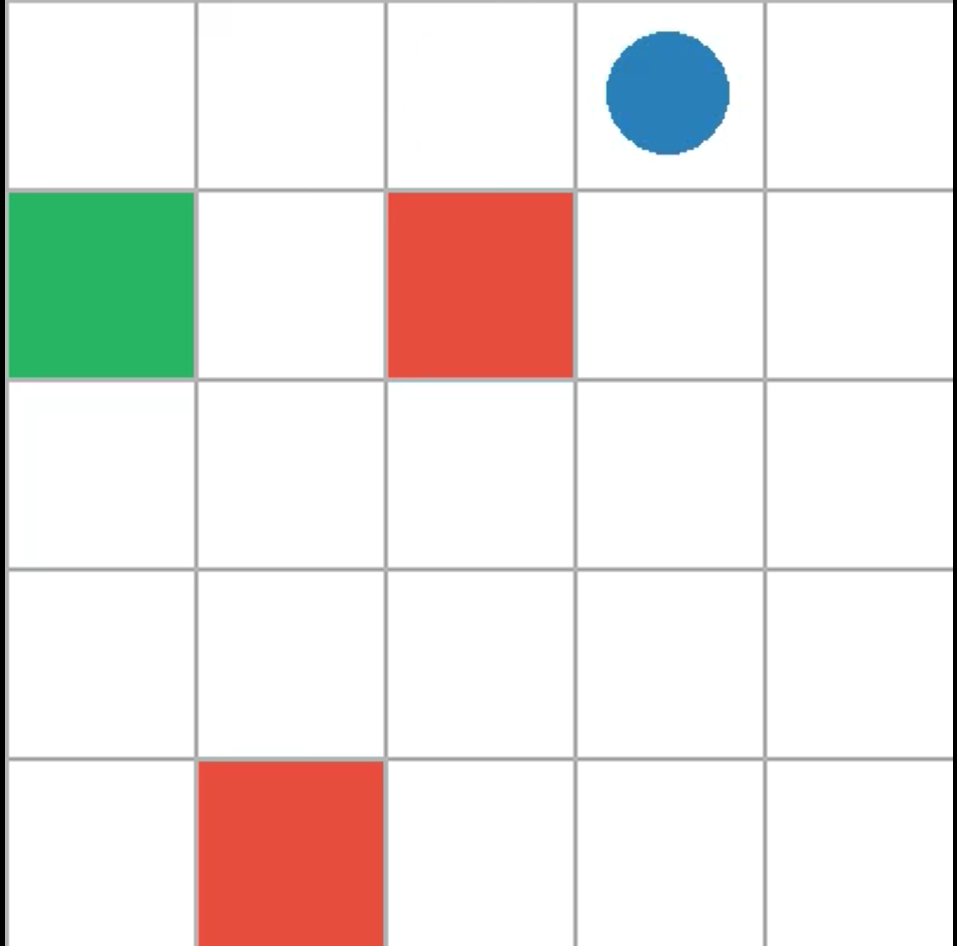
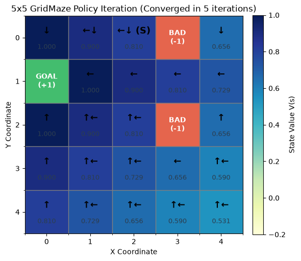
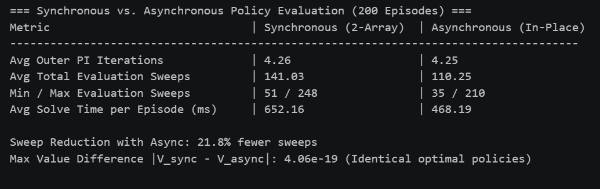
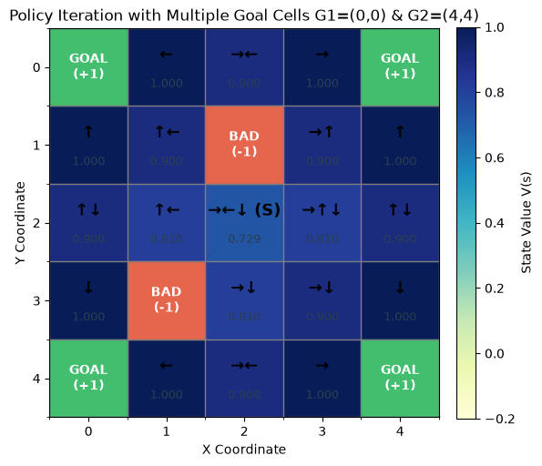

# CMPS458: Reinforcement Learning — Fall 2026

# Assignment 2 Report: Policy Iteration & Custom Gym Environment

**Student Name:** `Belal Mohamed -  Mohamed Magdy`  
**Student ID:** `1220042 - 1220021`  
**GitHub Repository Link:** https://github.com/Mmagdy908/RL_Assignment-2_Policy-Iteration.git

---

## 1. Outcome Summary

### 1.1 Environment Implementation (`GridMazeEnv`)

- **State / Observation Space:** A $5 \times 5$ grid with an 8-integer `Box` observation space `[agent_x, agent_y, goal_x, goal_y, bad1_x, bad1_y, bad2_x, bad2_y]`. On every `reset()`, the environment uniformly samples 4 distinct coordinates for the Agent Start (`S`), Goal (`G`), and two Bad cells (`X1`, `X2`).
- **Action Space & Transition Dynamics:** `Discrete(4)` deterministic movement actions (`0`: Right, `1`: Up, `2`: Left, `3`: Down), clipped to `[0, 4]` at grid boundaries.
- **Reward Function & Termination Conditions:** $+1.0$ upon reaching the Goal cell (`terminated = True`), $-1.0$ upon reaching either Bad cell (`terminated = True`), and $0.0$ otherwise, with episode truncation at `max_steps = 100`.
- **Environment Rendering & Video Recording:** Supports `"ansi"` (text grid), `"human"` (interactive PyGame window), and `"rgb_array"` (off-screen RGB array), recorded into `.mp4` videos via Gymnasium's `RecordVideo` wrapper.

  

---

### 1.2 Policy Iteration Implementation

- **Initialization:** $V(s)$ is initialized to zeros of shape `(5, 5)`, and the stochastic policy $\pi(s, a)$ is initialized uniformly to $0.25$ across all 4 actions of shape `(5, 5, 4)`.
- **Policy Evaluation (Prediction):** Uses synchronous two-array Bellman expectation updates ($V$ and $V_{\text{new}}$) with $\gamma = 0.9$ and zero future value at terminal states until $\max_s |V_{\text{new}}(s) - V(s)| < \theta$ ($\theta = 10^{-6}$).
- **Policy Improvement (Control):** Computes $Q(s, a) = r + \gamma V(s')$ for all 4 actions, splits probability equally ($\frac{1}{|\text{best\_actions}|}$) across tied optimal actions (`atol = 1e-8`), and stops when the policy is stable (`np.allclose`).

---

### 1.3 Experimental Results & Agent Performance

| Metric                                             | Value / Result               |
| :------------------------------------------------- | :--------------------------- |
| **Number of Test Episodes**                        | 200                          |
| **Success Rate (Reached Goal `G`)**                | 100.00% (200/200)            |
| **Collision Rate (Reached Bad Cell `X`)**          | 0.00% (0/200)                |
| **Truncation Rate (Trapped / Unsolvable Layouts)** | 0.00% (0/200)                |
| **Average Steps to Goal**                          | 3.38 ± 1.77                  |
| **Average Policy Iteration Outer Iterations**      | mean=4.42, min=3, max=6      |
| **Average Policy Evaluation Sweeps**               | mean=152.56, min=53, max=252 |

In a small-sized 5 x 5 Grid Maze, Policy Iteration succeeded to reach an optimal policy achieving 100% success and converges in around 4.4 policy improvements.

---

## 2. Assignment Questions & Answers

### Question 1: What is the state-space size of the 5x5 Grid Maze problem?

**Answer:**

Full State Space = 25 \* 24 \* ${23 \choose 2}$ = 151, 800
Per-Episode State Space = 22

---

### Question 2: How to optimize the policy iteration for the Grid Maze problem?

**Answer:**  
1- Skipping terminal states, so we have only 22 states per episodes.
2- Updating V in place instead of using 2 tables saving more space and also helps converging faster, however it is dependent on the update order

---

### Question 3: How many iterations did it take to converge on a stable policy for 5x5 maze?

**Answer:**  
4.42 iterations on average

---

### Question 4: Explain, with an example, how policy iteration behaves with multiple goal cells.

**Answer:**  
States tends to move to nearest goal to them, making agent reach goal faster, propagating reward faster and converging faster.

---

### Question 5: Can policy iteration work on a 100x100 maze? Explain why?

**Answer:**  
Yes, partially, actually it will take too many iterations (at worst case 198 iterations) for reward to propagate towards agent's start position, also it will be reward effect will fade out at $\gamma$ = 0.9 with $0.9^{198}$

---

### Question 6: Can policy iteration work on a continuous-space maze? Explain why?

**Answer:**  
No, because policy iteration need to iterate on all states for policy evaluation and in continuous space maze, states count is infinite.

---

### Question 7: Can policy iteration work with moving bad cells (like Pacman moving ghosts)? Explain why?

**Answer:**  
No, as moving pacman ghosts are moving unexpectedly, so no model-based RL technique(like policy iteration) can manage it. Model-free techniques can fit in this case.
